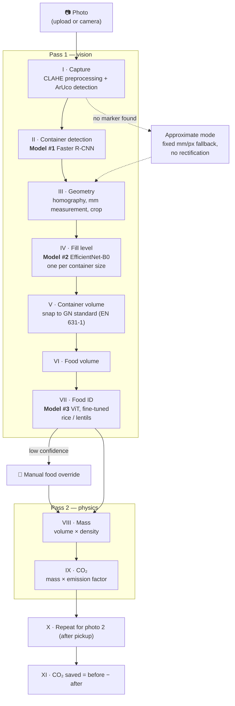

# GN Food Estimator

**From two phone photos to the CO₂ saved by rescuing leftover canteen food.**


- **Problem:** Canteens throw away large amounts of leftover food. [Food Be Good](https://www.foodbegood.app/) redistributes it, but how much food (and CO₂) each pickup saves goes unmeasured.
- **Motivation:** Weighing every Gastronorm (GN) container at pickup is impractical. Taking a photo with a phone is not.
- **Approach:** A computer-vision pipeline with three deep-learning models. A photo calibrated with an ArUco marker goes through container detection, fill-level classification and food identification, then volume, mass and CO₂ estimation.
- **Result:** A working Streamlit app. Photos taken before and after a pickup produce the CO₂ saved per container and in total. Food identification is 100 % correct on the held-out test set. Fill-level estimation is the weak link, at 72 % / 48 % validation accuracy (large / small containers).
- **Demo:** see the [demo below](#demo), or [run it locally](#run-locally) in a few commands.

Developed for **Food Be Good**, a food-sharing startup that connects canteens with visitors to reduce food waste.

---

## Demo

<!-- TODO: uncomment once the files exist in screenshots/ (see screenshots/README.md)
<p align="center">
  
</p>

| Detection + ArUco calibration | Per-container results | CO₂ saved |
|:---:|:---:|:---:|
|  |  |  |
-->

*Screenshots coming soon.*

---

## How it works

The user takes a top-down photo of the GN containers with an ArUco marker in view, once **before** and once **after** the pickup. Each photo goes through stages I–IX, and stage XI compares the two results.



The physical estimate after the models:

```text
food_volume_L = container_volume_L × fill_ratio        # fill: empty 0 · low 0.2 · medium 0.5 · high 0.75 · full 0.95
mass_kg       = food_volume_L × density_kg_per_L       # rice 0.85 · lentils 0.90
CO2_kg        = mass_kg × emission_factor              # rice 2.7 · lentils 0.9 kg CO₂e/kg
```

The pipeline degrades gracefully. When the ArUco marker is missing, it continues in *approximate mode* and warns the user. Low-confidence fill or food predictions are flagged, and the user can correct the food type before mass and CO₂ are calculated.

---

## Models & metrics

| # | Task | Architecture | Data (train / val / test) | Result |
|---|------|--------------|---------------------------|--------|
| 1 | GN container detection (small / large) | Faster R-CNN ResNet-50 FPN (torchvision), frozen-backbone warm-up → full fine-tune | 503 images (402 / 50 / 51) | Best val loss **0.059** · test mAP *TBD* |
| 2a | Fill level, **large** container (5 classes) — *used in app* | EfficientNet-B0 (timm + fastai) | 250 images (200 / 25 / 25), classes balanced | Val accuracy **0.72**, macro-F1 **0.76** |
| 2b | Fill level, **small** container (5 classes) — *used in app* | EfficientNet-B0 (timm + fastai) | 253 images (202 / 25 / 26), classes balanced | Val accuracy **0.48**, macro-F1 **0.49** |
| 2 | Fill level, both sizes combined — *fallback* | EfficientNet-B0 (timm + fastai) | 503 images (402 / 50 / 51) | Val accuracy **0.60**, macro-F1 **0.60** |
| 3 | Food identification (rice vs lentils) — *used in app* | ViT-B/16 (`nateraw/food`), new 2-class head, frozen-backbone warm-up → last 3 blocks unfrozen | 483 crops (340 / 69 / 74) | Test accuracy **100 %** (74/74), macro-F1 **1.00** |

The five fill classes are `empty`, `low`, `medium`, `high` and `full`, where chance level is 0.20. The app sends each detected container to the Model #2 variant trained for its size. The Model #2 scores come from 25-image validation sets, so they are noisy. The held-out test splits are saved in [`streamlit_app_local/src/models/training/`](streamlit_app_local/src/models/training/) but have not been scored yet. Model #3's perfect score covers two visually distinct foods only.

Images were annotated with [Label Studio](https://labelstud.io/), and all models were trained on Kaggle GPUs (Tesla T4). Training notebooks:

- [`model1_object_detection_v1.ipynb`](training_notebook/model1_object_detection_v1.ipynb)
- [`model2_fill_level_classifier_v1.ipynb`](training_notebook/model2_fill_level_classifier_v1.ipynb) · [small](training_notebook/model2_fill_level_classifier_small_v1.ipynb) · [large](training_notebook/model2_fill_level_classifier_large_v1.ipynb)
- [`model3_food_classifier_v1.ipynb`](training_notebook/model3_food_classifier_v1.ipynb)

**Tech stack:** PyTorch · torchvision · fastai · timm · Hugging Face Transformers · OpenCV (ArUco, homography) · Streamlit · pandas · Label Studio · Kaggle

---

## Run locally

Requires **Python 3.12** and **[Git LFS](https://git-lfs.com/)** (the model weights are stored with LFS).

```powershell
git clone https://github.com/matarauj/project_gn_food_estimator.git
cd project_gn_food_estimator
git lfs pull                                    # fetch model weights (~800 MB)

py -3.12 -m venv .venv
.venv\Scripts\Activate.ps1
pip install -r streamlit_app_local\requirements.txt

cd streamlit_app_local\src
streamlit run app.py                            # opens http://localhost:8501
```

- On the first run, the app fetches the `nateraw/food` architecture config from the Hugging Face Hub and caches it locally. The fine-tuned weights come from the repo.
- Every photo needs an **ArUco marker** in view: `DICT_4X4_50`, ID 0–5, **94 mm** side. Without one, the app falls back to approximate mode.
- To try the UI without model weights, set `STUB_MODE = True` in [`config.py`](streamlit_app_local/src/config.py).
- For NVIDIA GPU (CUDA) setup and more details, see [`streamlit_app_local/README.md`](streamlit_app_local/README.md).

---

## Repository structure

```text
project_gn_food_estimator/
├── README.md
├── LICENSE
├── screenshots/                  # demo GIF and app screenshots
├── training_notebook/            # Kaggle training notebooks for Models #1–#3
└── streamlit_app_local/
    ├── README.md                 # detailed local setup
    ├── requirements.txt
    └── src/
        ├── app.py                # Streamlit UI (tabs: before / after / comparison)
        ├── config.py             # thresholds, GN sizes, densities, CO₂ factors
        ├── cv_tasks/             # ArUco, homography, preprocessing, model loading
        ├── pipeline/             # stages I–XI, one module per stage
        └── models/               # Model #1–#3 weights (Git LFS)
            └── training/         # training logs and held-out test splits
```

---

## Limitations & next steps

| Limitation | Next step |
|------------|-----------|
| Only two foods (rice, lentils) and two GN container sizes are supported. | Collect and annotate more dishes and container sizes. |
| Fill level is the weakest stage: 0.72 / 0.48 validation accuracy (large / small) on 5 discrete bins, trained on only ~200 images per size. About half of the validation images fall below the 0.70 confidence threshold, which triggers a "retake photo" prompt. | Collect more images (especially of small containers), then try ordinal regression or regressing fill ratio directly. |
| Model #3 recognises only rice and lentils. Its perfect test score says little about other dishes or harder lighting. | Add more foods, and keep the stock 101-class `nateraw/food` as an option (`MODEL3_FINETUNED = False`). |
| Model #1 is evaluated by loss only, and Model #2 only on its validation sets. | Score all models on the held-out test splits, including COCO mAP for detection. |
| Container depth is not measured. Volume comes from the detected GN size, snapped to the EN 631-1 standard. | Estimate depth or food surface height (e.g. from stereo or monocular depth). |
| Without an ArUco marker, the scale falls back to a fixed 0.5 mm/px. | Derive the scale from the known GN container dimensions. |
| CO₂ factors are German/Bavarian averages (ifeu 2020, KTBL) and only indicative. | Use supplier-specific factors where available. |
| No hosted demo at the moment. | Redeploy (e.g. Hugging Face Spaces). |

---

## Data

The image dataset (top-down photos of GN containers at varying fill levels, annotated in Label Studio) is not included in this repository. It is available on request.

## Acknowledgements

- [Food Be Good](https://www.foodbegood.app/), for the use case and collaboration
- [`nateraw/food`](https://huggingface.co/nateraw/food), a ViT fine-tuned on Food-101
- CO₂ emission factors: ifeu (2020), KTBL

## License

[MIT](LICENSE) © 2026 Matias G.A.
